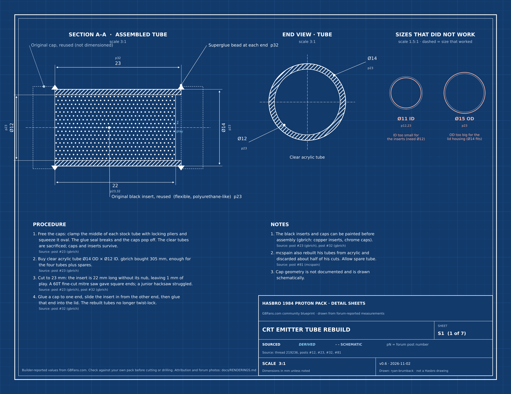

# Hasbro 1984 Proton Pack: Blueprint and Reference

A community-sourced, fully attributed reference for the **Hasbro 1984 Proton Pack** (Hasbro Pulse G19145L00), written for the [GBFans.com wiki](https://www.gbfans.com/wiki). Its purpose is a **measured blueprint of the whole pack**, built from photographs and checked against parts of known size, with every value traced to its source. Disassembly and modification notes from a 91-post forum build thread are included as supporting sections. Every claim links to the post or page it came from.

**Status:** draft v0.4, **not yet verified against the original posts**. See [Verification](#verification).

| | |
|---|---|
| Subject | Hasbro 1984 Proton Pack (and its Neutrona Wand, in the supporting sections) |
| Blueprint so far | Overall height about 655 mm (640–680, frame-based); motherboard outline (lower section about 297 mm, top 324 mm, 341 mm at the gearbox step); cyclotron rear panel 262 mm, cake top 141 mm, cake height 46 mm; general arrangement in progress. Register: [`data/measurements.json`](data/measurements.json); method: [`docs/METHOD.md`](docs/METHOD.md) |
| Primary sources | Hasbro product photos; GBFans thread [Hasbro 1984 Proton Pack BIG Overhaul and Customisation](https://forum.gbfans.com/t/hasbro-1984-proton-pack-big-overhaul-and-customisation/219236), posts #1–91; 96 related Hasbro/HasLab forum topics |
| Wiki draft | [`docs/wiki/hasbro-1984-proton-pack.md`](docs/wiki/hasbro-1984-proton-pack.md), about 4,200 words, 59 posts cited |
| Drawings | 7 part sheets ([preview and attribution](docs/RENDERINGS.md), [printable PDF](docs/drawings/blueprints.pdf)); whole-pack sheets in progress |
| Attribution | footnote on every claim; every drawn dimension linked to its post and the forum photos of that part ([RENDERINGS.md](docs/RENDERINGS.md)); [verification checklist](docs/VERIFICATION.md) per post |

This guide builds directly on the work of gbrich, nomake-wan, spooky, mcspain, cantignie and other GBFans members. See **[Credits](#credits)**.

---

## Contents

- [Why this exists](#why-this-exists)
- [How it's made](#how-its-made)
- [Drawings](#drawings)
- [Status labels](#status-labels)
- [Verification](#verification)
- [Files](#files)
- [Updating the guide](#updating-the-guide)
- [Credits](#credits)
- [Legal](#legal)

Detailed documentation: [Renderings and attribution](docs/RENDERINGS.md) · [Source index](docs/SOURCES.md) · [Verification checklist](docs/VERIFICATION.md) · [Research log](docs/RESEARCH.md) · [Wiki page workflow](docs/wiki/) · [Outreach](docs/wiki/forum_posts.md)

---

## Why this exists

The Hasbro 1984 overhaul thread is the most-viewed active thread in the GBFans Equipment section (about 1,000 views and 89 replies in its first three months). It holds answers to the questions people keep asking: how to remove the HGA, how to split the cyclotron lid, what size tube replaces the emitter tubes. But the answers are spread through a long build log.

The GBFans wiki documents the screen-used props in detail, but it has no page on modding the consumer packs, and the forum's Proton Pack index thread dates from 2011. This guide fills that gap.

## How it's made

1. **Read the whole thread.** Every post is indexed in [docs/SOURCES.md](docs/SOURCES.md) with what it contributes.
2. **Extract techniques, measurements and lessons**, keeping each one tied to its post number and author.
3. **Reorganize by task** rather than by date, so a builder can go straight to "remove the HGA" or "rebuild the emitter tubes".
4. **Paraphrase, don't copy.** Steps are rewritten in plain language. Members' photos are not reproduced. The page links to the posts instead.
5. **Footnote every claim** using the wiki's footnote syntax, one footnote per post, linking directly to that post.
6. **Verify every statement against its post** before publishing ([checklist](docs/VERIFICATION.md)).
7. **Contact the authors** before publishing, to share the draft, ask for corrections and ask permission to use any of their photos ([outreach drafts](docs/wiki/forum_posts.md)).

## Drawings

Seven part sheets turn the reported measurements into drawings (whole-pack sheets will follow the general arrangement):

| Sheet | Shows | Scale |
|---|---|---|
| S1 | CRT emitter tube rebuild: section, end view, sizes that didn't fit | 3:1 |
| S2 | ALICE frame mounting spacer, and why it's needed | 3:1 |
| S3 | ALICE frame neck pad: section and covering flat pattern | 1:1 |
| S4 | BNC cable ends | schematic |
| S5 | Ion arm end cap pinning | schematic |
| S6 | HGA removal, four steps | schematic |
| S7 | Every reported hole and fastener size, at true size | 1:1 |



**The drawing rule mirrors the Ecto-1A project:** a value is drawn only if a post states it (white, labeled with its post number, for example `p23`) or it is calculated from stated values (light blue italics, with the calculation in [RENDERINGS.md](docs/RENDERINGS.md)). Shapes and positions nobody measured are drawn dashed and stamped *schematic — not to scale*. [RENDERINGS.md](docs/RENDERINGS.md) lists every value on every sheet with its source post, and links each sheet to the forum photos of the same part so the drawing can be checked against the real thing. Photos are linked, not copied.

Every value lives in one file, [`tools/drawing_data.py`](tools/drawing_data.py). Change a value there and rerun `python tools/make_drawings.py` to redraw the sheets and regenerate the attribution. [`blueprints.pdf`](docs/drawings/blueprints.pdf) is US Letter landscape; print at 100% and check S7's 50 mm bar.

## Status labels

The source is builder reports, not reference footage, so the labels differ from the Ecto-1A project:

| Label | Meaning |
|---|---|
| **reported** | one builder did this on their own pack |
| **corroborated** | a second builder confirmed the same method or result |
| **as reported at the time** | prices, stock, lead times and vendor policies, which change |
| *(unlabeled)* | stated in the thread without dispute, for example a part being glued |

Opinions (for example "the inner cyclotron is the weakest area") are attributed to the person who said them.

## Verification

The first draft was compiled from structured summaries of each thread page, so exact figures and part names may have drifted. Before the page goes live, every statement needs checking against the original post:

```bash
python tools/check_wiki.py
```

This checks the footnotes and links, and regenerates [docs/VERIFICATION.md](docs/VERIFICATION.md): one section per cited post, listing every statement on the page that cites it. Open the post, check each statement, tick the post off, and add a `- Note:` line for any correction. Ticks and notes survive regeneration.

## Files

| Path | What |
|---|---|
| [`docs/wiki/hasbro-1984-proton-pack-modding.md`](docs/wiki/hasbro-1984-proton-pack-modding.md) | The wiki page (Markdown, as accepted by the wiki editor: no tables, `[^id]` footnotes) |
| [`docs/wiki/page.json`](docs/wiki/page.json) | Title, proposed URL and location, tags, edit summary, version |
| [`docs/wiki/forum_posts.md`](docs/wiki/forum_posts.md) | Outreach drafts and a record of forum correspondence |
| [`docs/SOURCES.md`](docs/SOURCES.md) | Index of all 91 posts, coverage, related threads to mine next |
| [`docs/VERIFICATION.md`](docs/VERIFICATION.md) | Generated per-post verification checklist |
| [`docs/RESEARCH.md`](docs/RESEARCH.md) | Method and revision history |
| [`docs/RENDERINGS.md`](docs/RENDERINGS.md) | Generated: every sheet, every value with its source post, links to the forum photos |
| [`docs/drawings/`](docs/drawings/) | Sheets as PNG (for the wiki) and SVG, plus `blueprints.pdf` for printing |
| [`tools/drawing_data.py`](tools/drawing_data.py) | Every drawn value with its post and status, and the forum photo links |
| [`tools/make_drawings.py`](tools/make_drawings.py) | Draws the sheets and writes RENDERINGS.md |
| [`tools/check_wiki.py`](tools/check_wiki.py) | Footnote, link, image and format checker; builds the checklist and a GitHub-image preview of the page |

## Updating the guide

1. Edit the wiki page here first, then publish to the wiki, so the two never drift apart.
2. If a measurement changed, update `tools/drawing_data.py` and run `python tools/make_drawings.py`.
3. Run `python tools/check_wiki.py`. It fails on undefined or unused footnotes, a post footnote that links to the wrong post, or a Markdown table.
4. Tick off newly verified posts in `docs/VERIFICATION.md`.
5. Bump `version` in `docs/wiki/page.json` and add a line to the revision log in [docs/wiki/README.md](docs/wiki/README.md).
6. Commit with the same summary as the wiki edit.

## Credits

The content of this guide comes from the GBFans thread **[Hasbro 1984 Proton Pack BIG Overhaul and Customisation](https://forum.gbfans.com/t/hasbro-1984-proton-pack-big-overhaul-and-customisation/219236)**:

- **gbrich** — started and documented the build: nearly every technique, measurement and lesson on the page.
- **nomake-wan** — the non-destructive HGA removal method, GPStar support as one of its developers, and historical context.
- **spooky** — HGA tips, the barrel extension, and fitting compatibility notes.
- **mcspain**, **cantignie**, **flashlight_buff** and everyone else who posted questions and progress.
- Video tutorials referenced in the thread by **Imperial Tech Shop** and **RSquad911**.

Compiled by **Ryan Brumback**, with AI assistance (Anthropic's Claude) for organizing the thread.

## Legal

Fan project for non-commercial use. *Ghostbusters* and related marks are the property of Columbia Pictures / Sony Pictures. Hasbro, HasLab, GPStar, Redman Studio Workshop and other product names belong to their owners. This project is not affiliated with or endorsed by any of them. Modifying the pack may void its warranty; you do so at your own risk.

The guide text and drawings are released under [CC BY 4.0](LICENSE) and the scripts under the MIT license (see [LICENSE](LICENSE)). The techniques belong to the forum members who shared them and are credited throughout. Forum posts and photos are not reproduced here.
