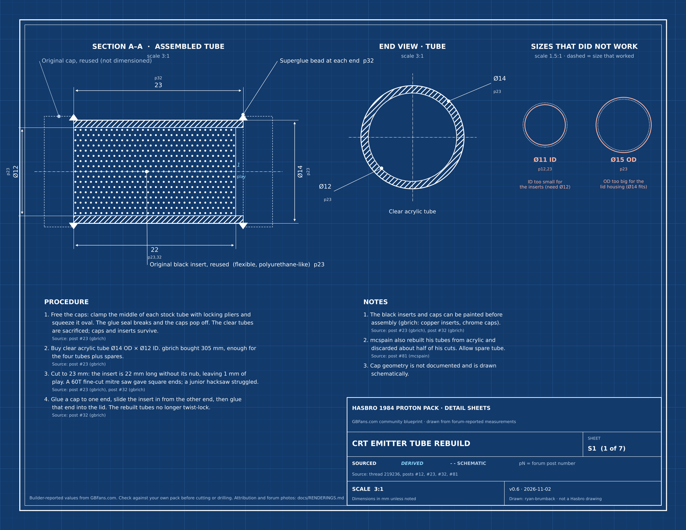
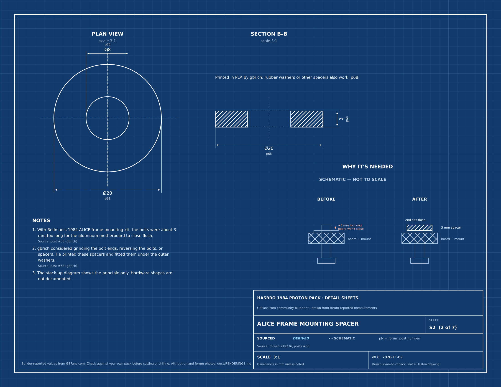
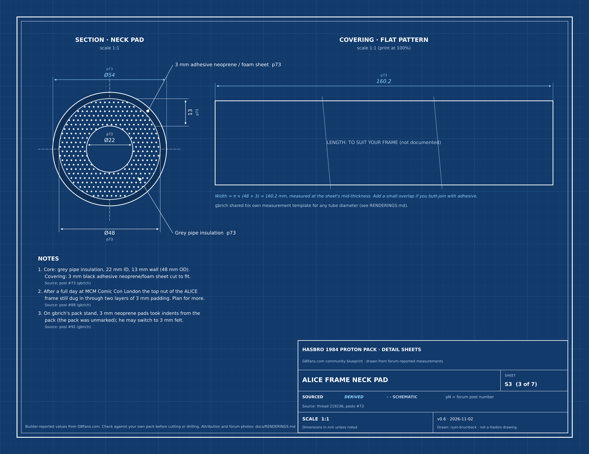
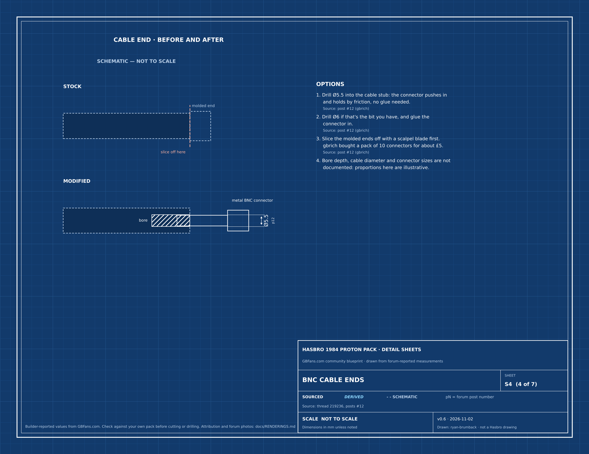
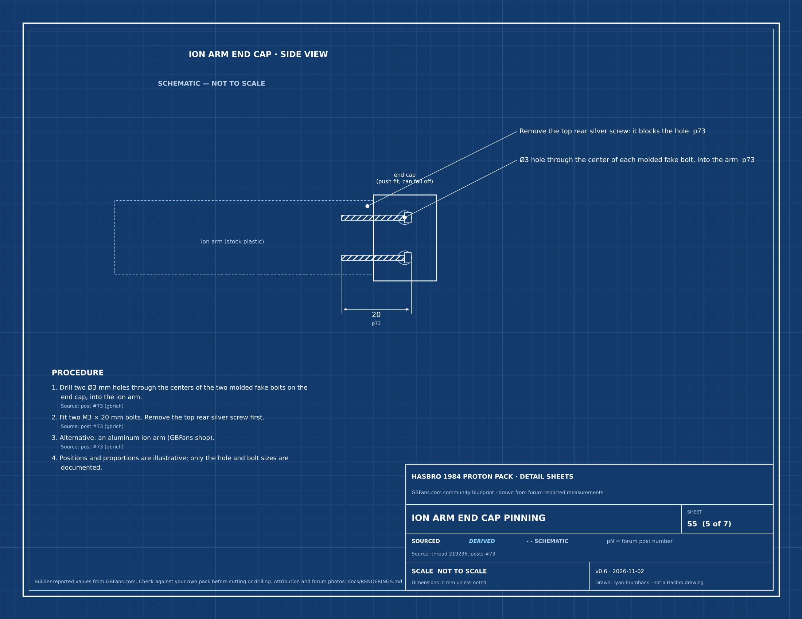
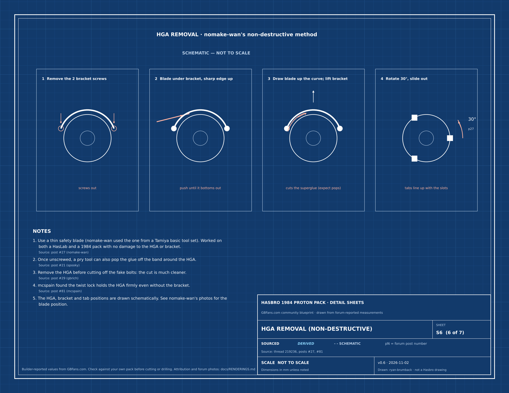
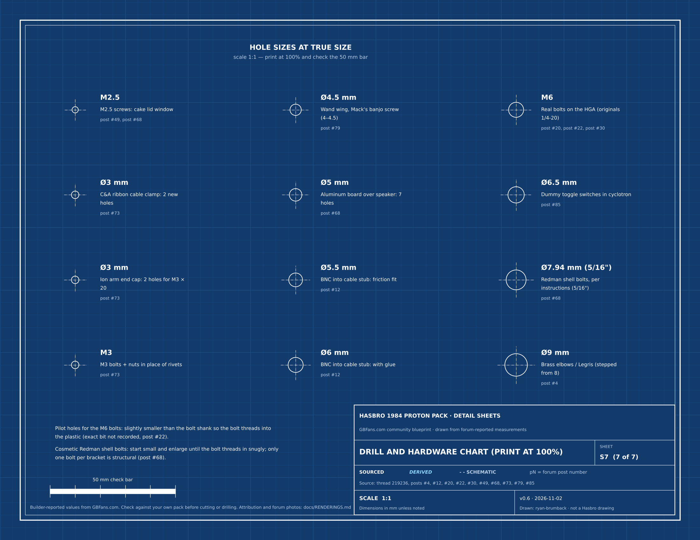

# Renderings and attribution

Generated by `tools/make_drawings.py` from [`tools/drawing_data.py`](../tools/drawing_data.py). Every value on every sheet is listed here with the post it comes from, and each sheet links to the forum photos that show the same part, so you can compare the drawing with the real thing.

**Rules:** a value is drawn only if a post states it (**sourced**) or it is calculated from sourced values (**derived**, shown in light blue italics with the calculation). Shapes and positions that nobody documented are drawn dashed and stamped **schematic — not to scale**. Forum photos are linked, not copied, and remain the property of the members who posted them.

**Printing:** [`drawings/blueprints.pdf`](drawings/blueprints.pdf) is US Letter landscape. Print at 100% (no fit-to-page). Sheet S7 has a 50 mm check bar.

## S1. CRT emitter tube rebuild

Scale: 3:1. Files: [PNG](drawings/s1_emitter_tubes.png) · [SVG](drawings/s1_emitter_tubes.svg)

| Value | Status | Source | Note |
|---|---|---|---|
| 14 mm | sourced | [post #23](https://forum.gbfans.com/t/hasbro-1984-proton-pack-big-overhaul-and-customisation/219236/23) (gbrich) | Clear acrylic tube outside diameter |
| 12 mm | sourced | [post #23](https://forum.gbfans.com/t/hasbro-1984-proton-pack-big-overhaul-and-customisation/219236/23) (gbrich) | Inside diameter |
| 23 mm | sourced | [post #32](https://forum.gbfans.com/t/hasbro-1984-proton-pack-big-overhaul-and-customisation/219236/32) (gbrich) | Cut length |
| 22 mm | sourced | [post #23](https://forum.gbfans.com/t/hasbro-1984-proton-pack-big-overhaul-and-customisation/219236/23) (gbrich), [post #32](https://forum.gbfans.com/t/hasbro-1984-proton-pack-big-overhaul-and-customisation/219236/32) (gbrich) | Black insert length, excluding its nub |
| 1 mm | derived | [post #32](https://forum.gbfans.com/t/hasbro-1984-proton-pack-big-overhaul-and-customisation/219236/32) (gbrich) | 23 mm tube - 22 mm insert |
| 11 mm | sourced | [post #12](https://forum.gbfans.com/t/hasbro-1984-proton-pack-big-overhaul-and-customisation/219236/12) (gbrich), [post #23](https://forum.gbfans.com/t/hasbro-1984-proton-pack-big-overhaul-and-customisation/219236/23) (gbrich) | ID that was too small for the inserts |
| 15 mm | sourced | [post #23](https://forum.gbfans.com/t/hasbro-1984-proton-pack-big-overhaul-and-customisation/219236/23) (gbrich) | OD that did not fit the lid housing |
| 305 mm | sourced | [post #23](https://forum.gbfans.com/t/hasbro-1984-proton-pack-big-overhaul-and-customisation/219236/23) (gbrich) | Length of tube bought |
| 60-tooth | sourced | [post #32](https://forum.gbfans.com/t/hasbro-1984-proton-pack-big-overhaul-and-customisation/219236/32) (gbrich) | Fine-cut mitre saw blade that gave square cuts |

**Compare with the forum photos:**

- [IMG_5104: emitter tubes cracked by prying](https://discdn.gbfans.com/original/3X/c/a/ca5f53d1c26ba9618ad24c283d3ee4dedf2f87ec.jpeg) — [post #12](https://forum.gbfans.com/t/hasbro-1984-proton-pack-big-overhaul-and-customisation/219236/12), gbrich
- [IMG_5113: original clear tubes after removal (sacrificed)](https://discdn.gbfans.com/original/3X/a/6/a685fa2601e29dd71ae8d87691c20b7ee9f270ab.jpeg) — [post #23](https://forum.gbfans.com/t/hasbro-1984-proton-pack-big-overhaul-and-customisation/219236/23), gbrich
- [IMG_5116: caps and inserts masked for paint](https://discdn.gbfans.com/original/3X/9/8/987eadaba7a3e18b9bd5233cc9ff8ceace7e2e4f.jpeg) — [post #23](https://forum.gbfans.com/t/hasbro-1984-proton-pack-big-overhaul-and-customisation/219236/23), gbrich
- [IMG_5127: caps and inserts after spraying](https://discdn.gbfans.com/original/3X/5/e/5e1276b442c2c3ba781998c24cc35fbf13eb1a25.jpeg) — [post #23](https://forum.gbfans.com/t/hasbro-1984-proton-pack-big-overhaul-and-customisation/219236/23), gbrich
- [IMG_5552: finished emitter tubes cut to 23 mm](https://discdn.gbfans.com/original/3X/7/2/729ccfe473d384e65d1785ca870994459b4164c8.jpeg) — [post #32](https://forum.gbfans.com/t/hasbro-1984-proton-pack-big-overhaul-and-customisation/219236/32), gbrich
- [IMG_5555: tubes being glued into the cyclotron lid](https://discdn.gbfans.com/original/3X/0/d/0d1639238d2563a52913959e65ce7c166ac67d7e.jpeg) — [post #32](https://forum.gbfans.com/t/hasbro-1984-proton-pack-big-overhaul-and-customisation/219236/32), gbrich
- [cyclotron-lid: before and after](https://discdn.gbfans.com/original/3X/4/8/48f0980617dd33628e7db98215becc16423ce67a.jpeg) — [post #32](https://forum.gbfans.com/t/hasbro-1984-proton-pack-big-overhaul-and-customisation/219236/32), gbrich
- [EmitterTubesLid: mcspain's rebuilt emitter tubes](https://discdn.gbfans.com/original/3X/7/8/7855f2a0fe5b7fdfa2f5d451331277bc1832f3fb.jpeg) — [post #81](https://forum.gbfans.com/t/hasbro-1984-proton-pack-big-overhaul-and-customisation/219236/81), mcspain

## S2. ALICE frame mounting spacer

Scale: 3:1. Files: [PNG](drawings/s2_alice_spacer.png) · [SVG](drawings/s2_alice_spacer.svg)

| Value | Status | Source | Note |
|---|---|---|---|
| 20 mm | sourced | [post #68](https://forum.gbfans.com/t/hasbro-1984-proton-pack-big-overhaul-and-customisation/219236/68) (gbrich) | Printed spacer outside diameter |
| 8 mm | sourced | [post #68](https://forum.gbfans.com/t/hasbro-1984-proton-pack-big-overhaul-and-customisation/219236/68) (gbrich) | Inside diameter |
| 3 mm | sourced | [post #68](https://forum.gbfans.com/t/hasbro-1984-proton-pack-big-overhaul-and-customisation/219236/68) (gbrich) | Thickness |
| 3 mm | sourced | [post #68](https://forum.gbfans.com/t/hasbro-1984-proton-pack-big-overhaul-and-customisation/219236/68) (gbrich) | How far the kit bolts were too long (approximate, 'about 3mm') |

**Compare with the forum photos:**

- [IMG_5734: ALICE mounting bolt protruding through the board](https://discdn.gbfans.com/original/3X/8/6/8617a022450044dc238221d11ee245b257f3959d.jpeg) — [post #68](https://forum.gbfans.com/t/hasbro-1984-proton-pack-big-overhaul-and-customisation/219236/68), gbrich
- [IMG_5757: printed spacer in place under the washer](https://discdn.gbfans.com/original/3X/b/a/ba92cbbc5e0e4d14edab1fcc1b80729ec17e01ea.jpeg) — [post #68](https://forum.gbfans.com/t/hasbro-1984-proton-pack-big-overhaul-and-customisation/219236/68), gbrich

## S3. ALICE frame neck pad

Scale: 1:1. Files: [PNG](drawings/s3_neck_pad.png) · [SVG](drawings/s3_neck_pad.svg)

| Value | Status | Source | Note |
|---|---|---|---|
| 22 mm | sourced | [post #73](https://forum.gbfans.com/t/hasbro-1984-proton-pack-big-overhaul-and-customisation/219236/73) (gbrich) | Pipe insulation inside diameter |
| 13 mm | sourced | [post #73](https://forum.gbfans.com/t/hasbro-1984-proton-pack-big-overhaul-and-customisation/219236/73) (gbrich) | Insulation wall thickness |
| 48 mm | sourced | [post #73](https://forum.gbfans.com/t/hasbro-1984-proton-pack-big-overhaul-and-customisation/219236/73) (gbrich) | Insulation outside diameter (22 + 2 x 13) |
| 3 mm | sourced | [post #73](https://forum.gbfans.com/t/hasbro-1984-proton-pack-big-overhaul-and-customisation/219236/73) (gbrich) | Adhesive neoprene/foam sheet |
| 54 mm | derived | [post #73](https://forum.gbfans.com/t/hasbro-1984-proton-pack-big-overhaul-and-customisation/219236/73) (gbrich) | 48 + 2 x 3 mm covering |
| 160.2 mm | derived | [post #73](https://forum.gbfans.com/t/hasbro-1984-proton-pack-big-overhaul-and-customisation/219236/73) (gbrich) | Covering width to wrap the insulation: pi x (48 + 3) mm, measured at the sheet's mid-thickness |

**Compare with the forum photos:**

- [IMG_5761: finished ALICE frame neck foam](https://discdn.gbfans.com/original/3X/9/4/946186e7698ba5ca50e5a9d541917266f9010966.jpeg) — [post #73](https://forum.gbfans.com/t/hasbro-1984-proton-pack-big-overhaul-and-customisation/219236/73), gbrich
- [Neck Foam: gbrich's measurement template](https://discdn.gbfans.com/original/3X/5/e/5eb3520831722e37c72fff487e17e01b0c75e60c.jpeg) — [post #73](https://forum.gbfans.com/t/hasbro-1984-proton-pack-big-overhaul-and-customisation/219236/73), gbrich

## S4. BNC cable ends

Scale: NOT TO SCALE. Files: [PNG](drawings/s4_bnc_ends.png) · [SVG](drawings/s4_bnc_ends.svg)

| Value | Status | Source | Note |
|---|---|---|---|
| 5.5 mm | sourced | [post #12](https://forum.gbfans.com/t/hasbro-1984-proton-pack-big-overhaul-and-customisation/219236/12) (gbrich) | Drill into cable stub for a friction fit, no glue |
| 6 mm | sourced | [post #12](https://forum.gbfans.com/t/hasbro-1984-proton-pack-big-overhaul-and-customisation/219236/12) (gbrich) | Alternative drill; needs glue |

**Compare with the forum photos:**

- [IMG_5097: metal BNC connectors](https://discdn.gbfans.com/original/3X/1/7/177493a655670df5f8cb4a0ef838caba481b5f3b.jpeg) — [post #12](https://forum.gbfans.com/t/hasbro-1984-proton-pack-big-overhaul-and-customisation/219236/12), gbrich
- [IMG_5098: BNC connectors pushed into the drilled cable stubs](https://discdn.gbfans.com/original/3X/5/a/5a8fd3c29df521ee6927cb05cd342840f6c136a1.jpeg) — [post #12](https://forum.gbfans.com/t/hasbro-1984-proton-pack-big-overhaul-and-customisation/219236/12), gbrich

## S5. Ion arm end cap pinning

Scale: NOT TO SCALE. Files: [PNG](drawings/s5_ion_arm_cap.png) · [SVG](drawings/s5_ion_arm_cap.svg)

| Value | Status | Source | Note |
|---|---|---|---|
| 3 mm | sourced | [post #73](https://forum.gbfans.com/t/hasbro-1984-proton-pack-big-overhaul-and-customisation/219236/73) (gbrich) | Two holes through the centers of the molded fake bolts |
| 20 mm | sourced | [post #73](https://forum.gbfans.com/t/hasbro-1984-proton-pack-big-overhaul-and-customisation/219236/73) (gbrich) | M3 x 20 mm bolts |

**Compare with the forum photos:**

- [IMG_5764: ion arm end cap secured with M3 bolts](https://discdn.gbfans.com/original/3X/3/0/30cef3101bbc421dd1a318e08f440654ca61d870.jpeg) — [post #73](https://forum.gbfans.com/t/hasbro-1984-proton-pack-big-overhaul-and-customisation/219236/73), gbrich

## S6. HGA removal (non-destructive)

Scale: NOT TO SCALE. Files: [PNG](drawings/s6_hga_removal.png) · [SVG](drawings/s6_hga_removal.svg)

| Value | Status | Source | Note |
|---|---|---|---|
| 2 | sourced | [post #27](https://forum.gbfans.com/t/hasbro-1984-proton-pack-big-overhaul-and-customisation/219236/27) (nomake-wan) | Bracket screws |
| 30° | sourced | [post #27](https://forum.gbfans.com/t/hasbro-1984-proton-pack-big-overhaul-and-customisation/219236/27) (nomake-wan) | Rotation to align the HGA tabs with the crank generator slots |

**Compare with the forum photos:**

- [IMG_0972s: where the blade goes between the HGA and bracket (arrowed)](https://discdn.gbfans.com/original/3X/b/b/bbc7d8c9da39f560af913a5786c007cea7b65b57.jpeg) — [post #27](https://forum.gbfans.com/t/hasbro-1984-proton-pack-big-overhaul-and-customisation/219236/27), nomake-wan
- [IMG_1808: HGA rotated and coming out](https://discdn.gbfans.com/original/3X/5/8/58513ec02c252dcf3d23b0b5deabb909facd3e60.jpeg) — [post #27](https://forum.gbfans.com/t/hasbro-1984-proton-pack-big-overhaul-and-customisation/219236/27), nomake-wan
- [Removed HGA (mcspain; bracket cut away)](https://discdn.gbfans.com/original/3X/6/3/635182272e7ce0eec857922744280b0c543de253.jpeg) — [post #81](https://forum.gbfans.com/t/hasbro-1984-proton-pack-big-overhaul-and-customisation/219236/81), mcspain

## S7. Drill and hardware chart (print at 100%)

Scale: 1:1. Files: [PNG](drawings/s7_drill_chart.png) · [SVG](drawings/s7_drill_chart.svg)

| Value | Status | Source | Note |
|---|---|---|---|
| 9 mm | sourced | [post #4](https://forum.gbfans.com/t/hasbro-1984-proton-pack-big-overhaul-and-customisation/219236/4) (gbrich) | Approximate hole for brass elbow/Legris ('I think you need 9mm'), widened from an 8 mm bit |
| 5.5 mm | sourced | [post #12](https://forum.gbfans.com/t/hasbro-1984-proton-pack-big-overhaul-and-customisation/219236/12) (gbrich) | Drill into cable stub for a friction fit, no glue |
| 6 mm | sourced | [post #12](https://forum.gbfans.com/t/hasbro-1984-proton-pack-big-overhaul-and-customisation/219236/12) (gbrich) | Alternative drill; needs glue |
| 5 mm | sourced | [post #68](https://forum.gbfans.com/t/hasbro-1984-proton-pack-big-overhaul-and-customisation/219236/68) (gbrich) | Seven holes in the aluminum motherboard over the GPStar speaker |
| 3 mm | sourced | [post #73](https://forum.gbfans.com/t/hasbro-1984-proton-pack-big-overhaul-and-customisation/219236/73) (gbrich) | Two holes just right of the stock clamp holes, for the C&A clamp |
| 3 mm | sourced | [post #73](https://forum.gbfans.com/t/hasbro-1984-proton-pack-big-overhaul-and-customisation/219236/73) (gbrich) | Two holes through the centers of the molded fake bolts |
| 4.5 mm | sourced | [post #79](https://forum.gbfans.com/t/hasbro-1984-proton-pack-big-overhaul-and-customisation/219236/79) (gbrich) | Wand wing hole widened with a 4 or 4.5 mm bit for the Mack's banjo screw |
| 6.5 mm | sourced | [post #85](https://forum.gbfans.com/t/hasbro-1984-proton-pack-big-overhaul-and-customisation/219236/85) (gbrich) | Two holes for dummy toggle switches in the cyclotron |
| 6 mm | sourced | [post #20](https://forum.gbfans.com/t/hasbro-1984-proton-pack-big-overhaul-and-customisation/219236/20) (gbrich), [post #22](https://forum.gbfans.com/t/hasbro-1984-proton-pack-big-overhaul-and-customisation/219236/22) (gbrich), [post #30](https://forum.gbfans.com/t/hasbro-1984-proton-pack-big-overhaul-and-customisation/219236/30) (nomake-wan) | Black M6 bolts and washers replacing molded HGA bolts; originals were 1/4-20 |
| 7.94 mm | sourced | [post #68](https://forum.gbfans.com/t/hasbro-1984-proton-pack-big-overhaul-and-customisation/219236/68) (gbrich) | 5/16 in, the hole size in Redman's instructions for the structural shell bolts |
| 2.5 mm | sourced | [post #49](https://forum.gbfans.com/t/hasbro-1984-proton-pack-big-overhaul-and-customisation/219236/49) (gbrich), [post #68](https://forum.gbfans.com/t/hasbro-1984-proton-pack-big-overhaul-and-customisation/219236/68) (gbrich) | M2.5 black button-head screws for the cake lid window |
| 3 mm | sourced | [post #73](https://forum.gbfans.com/t/hasbro-1984-proton-pack-big-overhaul-and-customisation/219236/73) (gbrich) | Short M3 button-head bolts and nuts replacing the rivets |

**Compare with the forum photos:**

- [IMG_5063: stock rubber fittings and hoses, before](https://discdn.gbfans.com/original/3X/8/f/8fc27369cfcc90504a5cfdd6c2bdfe78d027866c.jpeg) — [post #4](https://forum.gbfans.com/t/hasbro-1984-proton-pack-big-overhaul-and-customisation/219236/4), gbrich
- [IMG_5067: brass elbows and Legris fittings installed](https://discdn.gbfans.com/original/3X/5/b/5b83ace437106b0bf5f9232822a408251ccc7f42.jpeg) — [post #4](https://forum.gbfans.com/t/hasbro-1984-proton-pack-big-overhaul-and-customisation/219236/4), gbrich
- [IMG_5129: real M6 bolts in place of the molded HGA bolts](https://discdn.gbfans.com/original/3X/0/a/0a5dcbd15933941334e15af68c34ff1ca8251527.jpeg) — [post #20](https://forum.gbfans.com/t/hasbro-1984-proton-pack-big-overhaul-and-customisation/219236/20), gbrich
- [IMG_5685: frosted acrylic cake window on M2.5 screws](https://discdn.gbfans.com/original/3X/9/5/955d55b31f88b0e8ebce6a3804ec905114ea24f4.jpeg) — [post #49](https://forum.gbfans.com/t/hasbro-1984-proton-pack-big-overhaul-and-customisation/219236/49), gbrich
- [IMG_5703: speaker holes relative to the DANGER sticker](https://discdn.gbfans.com/original/3X/1/3/1386653b8604aa6fdcf65499419dfec7f81f2a3a.jpeg) — [post #68](https://forum.gbfans.com/t/hasbro-1984-proton-pack-big-overhaul-and-customisation/219236/68), gbrich
- [IMG_5725: mesh glued behind the speaker holes](https://discdn.gbfans.com/original/3X/3/6/361f31f99d4b7067fb7a3135c8ce4f69a973f8c2.jpeg) — [post #68](https://forum.gbfans.com/t/hasbro-1984-proton-pack-big-overhaul-and-customisation/219236/68), gbrich
- [IMG_5767: M3 bolts and nuts replacing the rivets](https://discdn.gbfans.com/original/3X/3/e/3ed46f523d34103e564da3cbc1c615cc99cb9ece.jpeg) — [post #73](https://forum.gbfans.com/t/hasbro-1984-proton-pack-big-overhaul-and-customisation/219236/73), gbrich
- [IMG_5765: C&A ribbon cable clamp on its new 3 mm holes](https://discdn.gbfans.com/original/3X/4/7/4735d371baf5abf1bd6882ee55603f619d47dac8.jpeg) — [post #73](https://forum.gbfans.com/t/hasbro-1984-proton-pack-big-overhaul-and-customisation/219236/73), gbrich

## Whole-pack sheets P1–P4

Generated by `tools/make_pack_drawings.py` (run it after `tools/make_drawings.py`, which rewrites this file) from the pixel readings in `tools/pack_data.py`. Every value traces to one of these photos (linked, not copied):

- [Hasbro product photo 1, front](https://cdn.media.amplience.net/i/hasbropulse/G19145L00_1.png): front layout (P1, P3), lid and lenses (P4).
- [Hasbro product photo 9, back](https://cdn.media.amplience.net/i/hasbropulse/G19145L00_9.png): motherboard outline, holes and slots (P1, P2).
- [Hasbro product photo 3, worn side](https://cdn.media.amplience.net/i/hasbropulse/G19145L00_3.png): schematic depths (P1).
- [Hasbro product photo 7, lid off](https://cdn.media.amplience.net/i/hasbropulse/G19145L00_7.png): cyclotron opening (P4).
- gbrich, [post #23](https://forum.gbfans.com/t/hasbro-1984-proton-pack-big-overhaul-and-customisation/219236/23): rear panel and cake on a cutting mat (P4).
- gbrich, [post #68](https://forum.gbfans.com/t/hasbro-1984-proton-pack-big-overhaul-and-customisation/219236/68) and [post #72](https://forum.gbfans.com/t/hasbro-1984-proton-pack-big-overhaul-and-customisation/219236/72): Rothco ALICE frame on the pack, which sets the overall height (all sheets).
